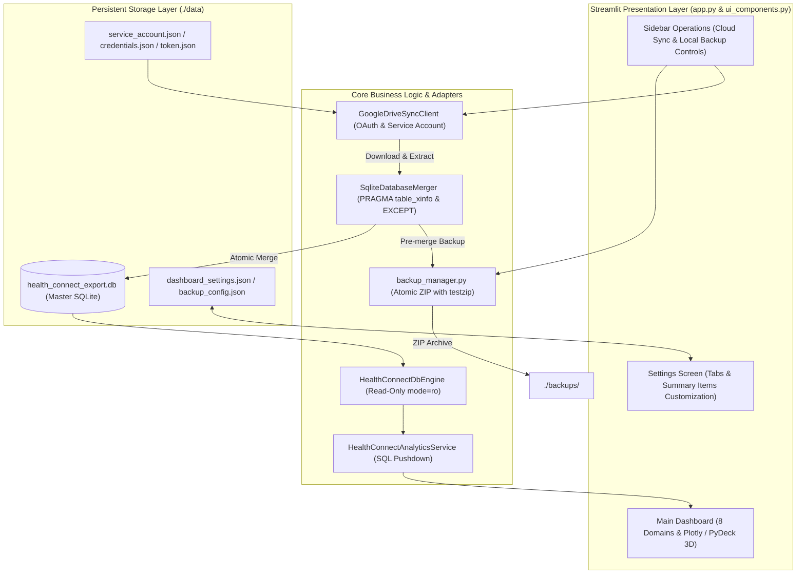
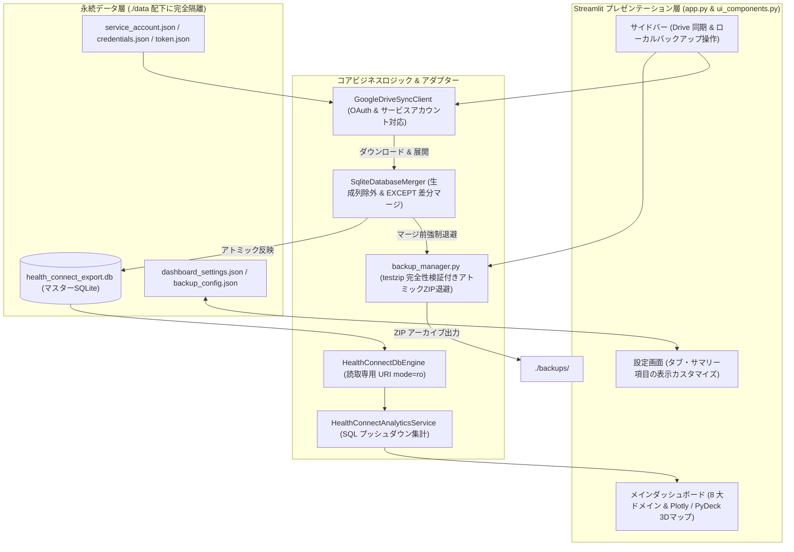

# Google Health Connect Full Viewer

> Comprehensive Streamlit dashboard for Google Health Connect SQLite exports with cloud differential merge and persistent data isolation.


[English](#english) | [日本語](#japanese)

---

<a name="english"></a>
## English Documentation

### 1. Overview
**Google Health Connect Full Viewer** is a production-grade analytics dashboard that inspects, visualizes, and explores SQLite database exports (`./data/health_connect_export.db`) from Android's Google Health Connect. It provides full traversal across all 77 schema tables and 8 primary health domains (Activity, Vitals, Sleep, Body Measurements, Nutrition, Medical Records, Devices, and Audit Logs), paired with Google Drive differential cloud synchronization and automated fail-safe ZIP backups.

### 2. System Architecture


### 3. Key Architectural Invariants
- **Full 77-Table Inspection & 8-Domain Visualization**: Processes 400,000+ records via read-only URI mode (`mode=ro`) and pushdown aggregations for composite activity trends, sleep stage Gantt timelines, vital distributions, and PyDeck 3D GPS route visualization.
- **Robust Differential Cloud Merge**: Automatically detects and downloads the newest SQLite or ZIP backup from Google Drive. Uses `PRAGMA table_xinfo` to bypass generated columns and `EXCEPT` set difference queries to safely merge rows without primary keys, guaranteeing zero duplicate creation.
- **Strict Persistent Data Isolation**: All mutable state, downloaded databases, and configurations are strictly isolated under `./data/`. Merges mandate pre-execution integrity backups via `backup_manager.run_backup()`.
- **Modern Streamlit Synthesis**: Fully adheres to Streamlit 1.66 standards (`width="stretch"` responsive containers, native `:material/...:` icons, `@st.fragment` partial reruns, and form batching).
- **High-Coverage Quality Assurance**: Maintained at 91%+ C1 branch test coverage across 89 unit and UI contract tests with `mypy --strict` and `ruff` enforcement.

### 4. Directory Structure
```text
.
├── .github/
│   └── workflows/
│       └── ci.yml             # GitHub Actions CI workflow (Python 3.14 + uv)
├── data/                      # Isolated persistent storage (ignored in git)
│   ├── health_connect_export.db   # Master SQLite database
│   ├── dashboard_settings.json    # UI tabs and summary visibility settings
│   ├── backup_config.json         # Local backup target directory configuration
│   ├── service_account.json       # (Optional) Google Cloud service account key
│   ├── credentials.json           # (Optional) Google OAuth 2.0 client secrets
│   └── token.json                 # Auto-generated OAuth 2.0 access token
├── backups/                   # Default local ZIP backup directory
├── tests/                     # 89 automated test suites (91%+ C1 branch coverage)
│   ├── test_analytics_service.py
│   ├── test_backup_manager.py
│   ├── test_db_engine.py
│   ├── test_db_merger.py
│   ├── test_domain_models.py
│   ├── test_drive_sync.py
│   ├── test_live_db_smoke.py
│   ├── test_settings_manager.py
│   └── test_ui_contracts.py
├── analytics_service.py       # SQL pushdown health metrics aggregation service
├── app.py                     # Streamlit orchestration entrypoint
├── backup_manager.py          # Atomic ZIP backup manager with testzip verification
├── db_engine.py               # Read-only SQLite engine for Health Connect schemas
├── db_merger.py               # Differential SQLite merger with schema adaptation
├── domain_models.py           # Immutable Pydantic v2 domain schemas and DTOs
├── drive_sync.py              # Google Drive API client (OAuth & Service Account)
├── pyproject.toml             # Python 3.14 project configuration & tool specs
├── run.bat                    # One-click Windows bootstrapping launcher
├── run.command                # One-click macOS/Linux bootstrapping launcher
├── settings_manager.py        # Dashboard settings persistence manager
├── ui_components.py           # Reusable Streamlit widgets and Plotly/PyDeck charts
└── uv.lock                    # Deterministic dependency lockfile
```

### 5. Setup & Execution

#### Prerequisites
- **Python**: `>=3.14` (Fallback: `3.13`)
- **Package Manager**: [`uv`](https://docs.astral.sh/uv/) (recommended)

#### Quick Start (Command Line)
```bash
# 1. Clone repository and sync dependencies
uv sync

# 2. (Optional) Place Google Cloud credentials under ./data/
# Copy service_account.json or credentials.json into ./data/

# 3. Launch the dashboard (opens at http://localhost:8501)
uv run streamlit run app.py
```

#### One-Click Launchers
- **Windows**: Double-click [`run.bat`](file:///e:/Python/Google_Health_Connect_viewer/run.bat) (auto-bootstraps `uv` and starts the app).
- **macOS / Linux**: Execute `./run.command` from the terminal or file manager.

### 6. Environment Variables & Configuration
| Setting / Env Variable | Default / Path | Description |
| :--- | :--- | :--- |
| `drive_folder_id` | `""` (`./data/dashboard_settings.json`) | Google Drive folder ID holding SQLite or ZIP backups |
| `BACKUP_DIR` | `./backups` (`./data/backup_config.json`) | Target directory path for local ZIP archives |
| `service_account.json` | `./data/service_account.json` | Google Cloud Service Account key (recommended for Advanced Protection accounts) |
| `credentials.json` | `./data/credentials.json` | OAuth 2.0 Client credentials file from Google Cloud Console |
| `token.json` | `./data/token.json` | Cached OAuth 2.0 token (refreshed automatically) |

### 7. Limits & Known Trade-offs
- **Google Advanced Protection Program**: Accounts with Google's Advanced Protection Program block standard OAuth loops (`Error 400: policy_enforced`). Use a Google Cloud Service Account (`./data/service_account.json`) and share the target Drive folder with the service account email.
- **SQLite Concurrency & Lock Escalation**: During differential merges, write operations obtain an exclusive lock (`BEGIN IMMEDIATE`). Dashboard read queries briefly wait and automatically refresh after completion via `st.cache_data.clear()`.

---

<a name="japanese"></a>
## 日本語ドキュメント

### 1. 概要
**Google Health Connect Full Viewer** は、Android の Google ヘルスコネクト (Google Health Connect) からエクスポートされた SQLite データベース（`./data/health_connect_export.db`）を直接読み込み、全 77 テーブルおよび 8 大健康ドメイン（アクティビティ、睡眠、バイタル、身体測定、栄養、医療レコード、デバイス、読取監査ログ）を完全走査・可視化する本番運用向け分析ダッシュボードです。Google Drive からのクラウド差分マージと完全性検証付き自動 ZIP バックアップを備えています。

### 2. システムアーキテクチャ


### 3. 主要な設計原則・特徴
- **全 77 テーブル完全走査 & 8 大ドメイン分析**: 40 万件超の生データを URI 読取専用モード (`mode=ro`) かつ SQL プッシュダウン集計で高速処理。日次歩数・距離、睡眠ステージ推移、バイタル時系列、身体測定、GPS 3D ルートマップなどをインタラクティブ可視化。
- **堅牢なクラウド差分同期マージ**: Google Drive 上の最新 SQLite または ZIP バックアップを自動検知して安全に取得。`PRAGMA table_xinfo` による生成列（Generated Columns）の動的除外および `EXCEPT` 集合演算クエリにより、主キーのないテーブルを含む全スキーマで重複を完全排除したアトミックマージを実現。
- **データ分離 & プレマージ自動バックアップ**: すべての動的永続データ・設定・DB を `./data/` 配下に厳格隔離。マージ直前に `backup_manager.run_backup()` による完全性検証（`testzip`）付き ZIP 退避を強制実行するフェイルセーフ設計。
- **最新 Streamlit 1.66 準拠**: `use_container_width` の完全撤廃（`width="stretch"` 統一）、ネイティブ Material Symbols（`:material/...:`）、`@st.fragment` による差分再描画、`st.form` によるフィルタ入力確定バッチ化を採用。
- **高カバレッジ品質保証**: 89 件のユニット・UI コントラクトテストによる C1 ブランチ網羅率 91%+、`mypy --strict` 完全型検査、`ruff` リント/フォーマットをクリア。

### 4. ディレクトリ構成
```text
.
├── .github/
│   └── workflows/
│       └── ci.yml             # GitHub Actions CI ワークフロー (Python 3.14 + uv)
├── data/                      # 永続データ隔離領域 (git 対象外)
│   ├── health_connect_export.db   # マスター SQLite データベース
│   ├── dashboard_settings.json    # タブ表示・サマリー項目表示設定
│   ├── backup_config.json         # ローカルバックアップ保存先設定
│   ├── service_account.json       # (任意) Google Cloud サービスアカウント鍵
│   ├── credentials.json           # (任意) Google OAuth 2.0 クライアント認証情報
│   └── token.json                 # 自動生成 OAuth 2.0 アクセストークン
├── backups/                   # 既定のローカル ZIP バックアップ保存先
├── tests/                     # 自動テスト群 (全 89 件、C1 ブランチ網羅率 91%+)
│   ├── test_analytics_service.py
│   ├── test_backup_manager.py
│   ├── test_db_engine.py
│   ├── test_db_merger.py
│   ├── test_domain_models.py
│   ├── test_drive_sync.py
│   ├── test_live_db_smoke.py
│   ├── test_settings_manager.py
│   └── test_ui_contracts.py
├── analytics_service.py       # SQL プッシュダウン分析集計サービス
├── app.py                     # Streamlit オーケストレーションエントリポイント
├── backup_manager.py          # testzip 検証付きアトミック ZIP バックアップマネージャー
├── db_engine.py               # ヘルスコネクト用読取専用 SQLite エンジン
├── db_merger.py               # スキーマ自動適応型 SQLite 差分マージャー
├── domain_models.py           # 不変 Pydantic v2 ドメインモデル & DTO
├── drive_sync.py              # Google Drive API クライアント (OAuth / サービスアカウント)
├── pyproject.toml             # Python 3.14 プロジェクト構成 & ツール定義
├── run.bat                    # Windows 向け自動セットアップ起動バッチ
├── run.command                # macOS/Linux 向け自動セットアップ起動スクリプト
├── settings_manager.py        # ダッシュボード設定永続化管理モジュール
├── ui_components.py           # 再利用可能 UI 部品および Plotly/PyDeck グラフ描画
└── uv.lock                    # 決定論的パッケージ依存関係ロックファイル
```

### 5. セットアップと実行方法

#### 前提環境
- **Python**: `>=3.14` (推奨) または `3.13`
- **パッケージマネージャー**: [`uv`](https://docs.astral.sh/uv/) (推奨)

#### コマンドラインからの起動
```bash
# 1. 依存関係の同期
uv sync

# 2. (任意) Google Cloud 認証情報の配置
# ./data/service_account.json または ./data/credentials.json を配置

# 3. ダッシュボードの起動 (ブラウザで http://localhost:8501 が自動オープン)
uv run streamlit run app.py
```

#### ワンクリック起動スクリプト
- **Windows**: [`run.bat`](file:///e:/Python/Google_Health_Connect_viewer/run.bat) をダブルクリック（`uv` の自動導入からアプリ起動まで完全自動実行）。
- **macOS / Linux**: `run.command` をターミナルまたは Finder から実行。

### 6. 設定・環境変数
| 設定項目 / 環境変数 | 規定値 / 保存先 | 概要 |
| :--- | :--- | :--- |
| `drive_folder_id` | `""` (`./data/dashboard_settings.json`) | SQLite または ZIP バックアップが格納されている Google Drive フォルダ ID |
| `BACKUP_DIR` | `./backups` (`./data/backup_config.json`) | ローカル ZIP バックアップの出力先ディレクトリパス |
| `service_account.json` | `./data/service_account.json` | Google Cloud サービスアカウント鍵（高度な保護機能プログラム適用アカウント推奨） |
| `credentials.json` | `./data/credentials.json` | Google Cloud Console (Desktop App) より取得した OAuth 2.0 クライアント認証情報 |
| `token.json` | `./data/token.json` | 初回ブラウザ認証完了時に自動生成・更新される Google Drive API アクセストークン |

### 7. 制約事項とトレードオフ
- **Google アカウント高度な保護機能プログラム**: 高度な保護機能が有効なアカウントではサードパーティ OAuth が遮断（`Error 400: policy_enforced`）されます。Google Cloud サービスアカウントキー（`./data/service_account.json`）を配置し、Drive フォルダを該当サービスアカウントと共有する方式を推奨します。
- **SQLite ロック競合**: 差分マージ中は排他書込ロック（`BEGIN IMMEDIATE`）を取得するため、ダッシュボード側の並行クエリは短時間待機となります（完了時に `st.cache_data.clear()` で自動リフレッシュ）。

---

Copyright (c) LLC Bocchi. All rights reserved.
